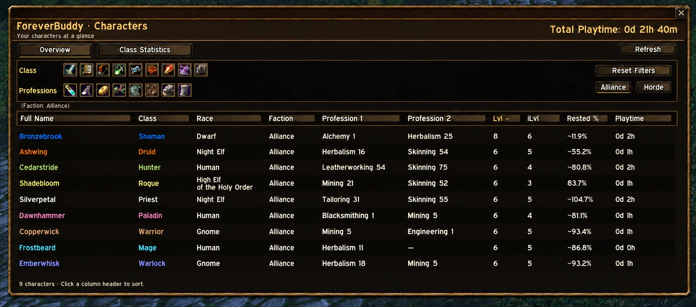

# ForeverBuddy 1.1.19

Eine kompakte Zentrale für Charaktere, Dungeon-Transmog, Schaden und Heilung, Aktionsleisten-Vorlagen und den Versand von Berufsmaterialien.

**Client:** WoW Forever · **Interface:** 16001 · **Eigenständig:** keine zusätzlichen Addons erforderlich.

[Wago](https://addons.wago.io/addons/foreverbuddy) · [CurseForge](https://www.curseforge.com/wow/addons/foreverbuddy-by-norushflow) · [GitHub Releases](https://github.com/norushflow/ForeverBuddy/releases)

## Einblicke

[Berufspost neben dem WoW-Briefkasten](branding/screenshots/profession-mail.webp) · [Schadens- und Heilungsanzeige](branding/screenshots/meters.webp)

## Funktionen

- BuddyRotation im Zauberbuch: Zauberfolgen erstellen, bearbeiten, auf die Aktionsleiste ziehen und löschen.

- Charakterübersicht mit Volk, Fraktionsfilter, angelegter Gegenstandsstufe und geschätzten Ruhe-EP anhand des letzten bekannten Ruheorts.
- Dungeon-Transmog und eigene Schadens-/Heilungsanzeige.
- Automatische Sicherung je Charakter und Klasse sowie Vorlagen je Klasse und Rolle, jeweils mit nativer Klickzauberbelegung.
- Berufspost mit sieben Berufen und einem Bankcharakter und getrennten Empfängern für Horde und Allianz.

## Sprachen und aktueller Stand

Die Spielsprache bestimmt die Texte: Deutsch (`deDE`), Englisch (`enUS`, `enGB`), sonst Englisch. Die gemeinsame Codebasis lädt `Locales/enUS.lua` und anschließend die deutschen Übersetzungen. Namen aus Blizzard-APIs (z. B. Gegenstände, Zauber und Klassen) folgen weiterhin der Clientsprache.

- Die Zentrale schließt beim Aufrufen eines Moduls; Aktionsleisten behalten das Menü offen.

## Installation

Das Installations-ZIP unter [Releases](https://github.com/norushflow/ForeverBuddy/releases) herunterladen und den enthaltenen Ordner `Foreverbuddy` in `Interface/AddOns/` des passenden Spielclients entpacken. Die Datei `Foreverbuddy.toc` muss direkt in diesem Ordner liegen. Anschließend im Spiel aktivieren und `/reload` ausführen.

Für WowUp die [Repository-Adresse](https://github.com/norushflow/ForeverBuddy) importieren und den passenden Spielclient wählen.

## Bedienung

- `/fb` oder `/foreverbuddy`: Zentrale öffnen.
- `/fb chars`, `/fb transmog`, `/fb meter`, `/fb bars`: Bereiche öffnen.
- `/fbbars speichern|laden|an|aus|status`: Leistenvorlagen verwalten.
- `/fb mail` oder `/fbmail`: Empfänger der Berufspost einstellen.
- Minimap-Kompass: Linksklick öffnet die Zentrale, Rechtsklick die Charakterübersicht.

**Aktionsleisten.** Wähle im Vorlagenbereich **Tank**, **Heiler** oder **Schaden**. ForeverBuddy merkt sich die Auswahl je Charakter. Mit **Vorlage speichern** sicherst du die Aktionsleisten 1–10, die nativen Blizzard-Klickzauber und die verwendeten Charaktermakros für diese Klasse und Rolle. **Vorlage laden** übernimmt die passende Vorlage nach Bestätigung. Auch das Überschreiben einer gespeicherten Vorlage erfordert eine Bestätigung. Die Auswahl und beide Schaltflächen stehen auch unter Stufe 10 zur Verfügung.

Die automatische Sicherung bleibt unter `ForeverbuddyCharDB.actions` erhalten. Gemeinsame Rollenvorlagen liegen in `ForeverbuddyDB.bars.library`. Ältere Klassenvorlagen sind weiterhin über `/fbbars laden` erreichbar. Beim Laden einer Rollenvorlage bleiben allgemeine Makros erhalten. Fehlende Charaktermakros werden bei verfügbarer Client-API angelegt. Bei einem gleichnamigen Charaktermakro mit anderem Inhalt bleibt die aktuelle Belegung erhalten.

**Berufspost:** Vor- und Nachnamen mit Leerzeichen als Empfänger eintragen. An der Mailbox dockt das Fenster rechts an; erst **Senden** startet den Versand. Weitere Briefe folgen nach Bestätigung, **Stoppen** verhindert weitere Briefe. Gemeinsam genutzte Materialien können an jeden passenden Beruf gehen. Mit **Senden** beim gewünschten Beruf wählst du den Empfänger für alle passenden Stapel in deinen Taschen. Vor dem Versand wird jeder Anhang geprüft. Gebundene oder gesperrte Gegenstände werden übersprungen; vorhandene Anhänge, Geld oder Nachnahme blockieren den Start. Nach Fehlern verbliebene Anhänge im normalen Briefentwurf prüfen.

Die Berufspost erkennt unterstützte Materialien anhand ihrer Gegenstands-ID.

## Änderungen und Entwicklung

Die [Versionshistorie](CHANGELOG.md) enthält ausschließlich Änderungen am Addon.
Prüfungen, Paketbau und noch offene Spieltests stehen in [Entwicklung und Release](DEVELOPMENT.md).
